# DER — E-commerce de Loja Única (Marca Própria Streetwear) · MySQL 8, 3FN

> DDL executável: [`database/schema.sql`](../database/schema.sql) · domínio: [`database/seed.sql`](../database/seed.sql)
> Este documento é o contrato do banco. Se algo aqui divergir do código, o código está errado.

---

## 1. O que este modelo NÃO tem (e por quê)

Ele nasceu de um marketplace multi-vendedor. Ao virar **loja única**, 8 tabelas deixaram de fazer sentido:

| Removido | Motivo |
|---|---|
| `vendedor` | não existe vendedor terceiro: a loja é a dona do catálogo |
| `subpedido` | sem N vendedores, o pedido tem itens diretos (`pedido → pedido_item`) |
| `envio` por subpedido | virou **1:1 com `pedido`** (uma loja, um despacho por pedido) |
| `regra_comissao`, `valor_comissao`, `valor_repasse` | não há comissão nem split de pagamento |
| `moderacao_vendedor` | não há vendedor para moderar |
| `marca`, `collab`, `collab_marca` | a marca **é** a loja — é identidade do sistema, não dado |
| `endereco.latitude/longitude` | sem filtro por distância de vendedor, geolocalização perdeu a função |

**Resultado:** 40 tabelas, 5 pivôs N:N, 4 views, 2 triggers, 69 → 54 FKs. Menos sistema, mesmo rigor.

E 4 coisas passaram a existir, porque loja única realmente precisa:

| Adicionado | Para quê |
|---|---|
| `tecido` | ficha técnica e a correção de 3FN da gramatura (ver §4) |
| `colecao` + `produto_colecao` (pivô) | "Essencial", "Drop Inverno": a mesma peça entra em 2 coleções |
| `status_publicacao` + `aprovacao_produto` | fluxo interno: operador cadastra, gerente publica |
| `avaliacao.resposta_loja` | a loja responde avaliação publicamente |

---

## 2. Os 4 níveis de acesso

| Nível | Papel | O que pode fazer |
|---|---|---|
| 1 | **Cliente Comprador** | catálogo, carrinho, checkout, histórico de pedidos, dados e endereços próprios |
| 2 | **Operador de Loja** | cadastrar produto, criar SKUs (cor × tamanho), movimentar estoque, ver pedidos, atualizar envio |
| 3 | **Gerente** | **publicar** produto, precificar (preço/promoção/cupom), relatórios, moderar avaliações, gerir clientes |
| 4 | **Proprietário** | acessos (inclusive de gerentes), logs de auditoria, faturamento, frete, credenciais do gateway |

**33 permissões**: cliente 5 · operador 15 · gerente 25 · proprietário 33 (todas).

> O coração desta versão é a fronteira **operador × gerente**: quem cadastra **não** publica.
> É o que substitui a "moderação" do marketplace — evita que preço errado ou foto trocada
> chegue à vitrine sem revisão.

---

## 3. DER (Mermaid)

```mermaid
erDiagram
    PAPEL ||--o{ PAPEL_PERMISSAO : possui
    PERMISSAO ||--o{ PAPEL_PERMISSAO : concede
    USUARIO ||--o{ USUARIO_PAPEL : recebe
    PAPEL ||--o{ USUARIO_PAPEL : classifica
    USUARIO ||--o{ SESSAO : autentica
    USUARIO ||--o{ ENDERECO : cadastra
    USUARIO ||--o{ PEDIDO : compra
    ENDERECO ||--o{ PEDIDO : entrega

    CATEGORIA ||--o{ CATEGORIA : "pai de"
    TECIDO ||--o{ PRODUTO : compoe
    CATEGORIA ||--o{ PRODUTO : classifica
    CONDICAO_PRODUTO ||--o{ PRODUTO : condiciona
    ESTILO_CAIMENTO ||--o{ PRODUTO : modela
    PUBLICO_ALVO ||--o{ PRODUTO : direciona
    STATUS_PUBLICACAO ||--o{ PRODUTO : situa

    PRODUTO ||--o{ PRODUTO_VARIANTE : "gera SKU"
    COR ||--o{ PRODUTO_VARIANTE : colore
    TAMANHO ||--o{ PRODUTO_VARIANTE : gradua
    PRODUTO ||--o{ PRODUTO_IMAGEM : exibe
    PRODUTO ||--o{ PRODUTO_TAG : etiqueta
    TAG ||--o{ PRODUTO_TAG : agrupa
    PRODUTO ||--o{ PRODUTO_COLECAO : participa
    COLECAO ||--o{ PRODUTO_COLECAO : reune
    USUARIO ||--o{ FAVORITO : salva
    PRODUTO ||--o{ FAVORITO : desejado
    USUARIO ||--o{ AVALIACAO : escreve
    PRODUTO ||--o{ AVALIACAO : recebe
    PEDIDO_ITEM ||--o| AVALIACAO : autoriza

    USUARIO ||--o{ CARRINHO : possui
    CUPOM ||--o{ CARRINHO : aplica
    CARRINHO ||--o{ CARRINHO_ITEM : contem
    PRODUTO_VARIANTE ||--o{ CARRINHO_ITEM : referencia

    STATUS_PEDIDO ||--o{ PEDIDO : situa
    CUPOM ||--o{ PEDIDO : desconta
    PEDIDO ||--o{ PEDIDO_ITEM : detalha
    PRODUTO_VARIANTE ||--o{ PEDIDO_ITEM : vende
    PEDIDO ||--o| ENVIO : despacha
    STATUS_ENVIO ||--o{ ENVIO : rastreia
    PEDIDO ||--o{ PEDIDO_STATUS_HISTORICO : audita
    STATUS_PEDIDO ||--o{ PEDIDO_STATUS_HISTORICO : registra
    CUPOM ||--o{ CUPOM_USO : consome
    PEDIDO ||--o| CUPOM_USO : aplica

    PEDIDO ||--o{ PAGAMENTO : cobra
    METODO_PAGAMENTO ||--o{ PAGAMENTO : instrui
    PAGAMENTO ||--o{ PAGAMENTO_EVENTO : "log webhook"

    USUARIO ||--o{ APROVACAO_PRODUTO : julga
    PRODUTO ||--o{ APROVACAO_PRODUTO : sofre
    STATUS_PUBLICACAO ||--o{ APROVACAO_PRODUTO : decide
    USUARIO ||--o{ CONFIGURACAO : ajusta
    USUARIO ||--o{ LOG_AUDITORIA : gera
```



---

## 4. Auditoria de 3FN (a parte que você precisa saber defender)

### 1FN — atomicidade
Nenhuma coluna guarda lista. Se a peça tem 2 cores e 5 tamanhos, isso são **linhas** em
`produto_variante` (10 SKUs), não um campo `tamanhos = 'P,M,G'`.

### 2FN — dependência da chave inteira
Em toda tabela de PK composta, os atributos dependem da **chave toda**:
- `produto_tag (produto_id, tag_id)` → não guarda nome da tag;
- `produto_colecao (produto_id, colecao_id)` → não guarda nome da coleção;
- `favorito (usuario_id, produto_id)` → `criado_em` depende do par, está no lugar certo;
- `papel_permissao`, `usuario_papel` → idem.

### 3FN — nenhum atributo não-chave depende de outro não-chave

A decisão mais importante do modelo:

> **A gramatura NÃO está em `produto`.** Ela está em `tecido`.
> "Algodão Pesado" **é** 240 g/m² — a gramatura é propriedade do tecido.
> Se `produto` guardasse `tecido_id` **e** `gramatura_gm2`, existiria a dependência transitiva
> `produto → tecido → gramatura`, violando a 3FN: ao corrigir a gramatura de um tecido, você
> teria que atualizar todos os produtos daquele tecido (e esqueceria algum).

Outros pontos verificados:
- `produto` tem `categoria_id`, **não** `nome_categoria`;
- `pedido` tem `endereco_entrega_id` (endereço congelado da entrega), **não** `cidade_entrega`;
- `pagamento` tem `metodo_id`, **não** `nome_metodo`;
- `cor.familia_cor` depende só da PK → OK, não é transitiva;
- média de avaliação, estoque somado e receita por mês **não são colunas**: são views.

### Exceção declarada (e justificada)
`pedido_item.preco_unitario` e os totais do `pedido` (subtotal, frete, desconto, total) são
**snapshots transacionais**. Não é redundância: é fato histórico imutável. Se o preço de tabela
subir amanhã, a nota fiscal de ontem não pode mudar.

### E o estoque?
`produto_variante.estoque` é a **fonte única** de saldo. Não existe tabela `movimento_estoque`
porque o saldo dela seria redundante com esta coluna. As movimentações (entrada de fornecedor,
ajuste de inventário, perda, devolução) ficam registradas em `log_auditoria` com `payload_json`
antes/depois.

> **Quando mudar isso:** no dia em que você precisar de relatório de giro/curva ABC por lote,
> vale criar o ledger `movimento_estoque` e assumir conscientemente o saldo materializado
> (padrão *ledger + balance*). Anote: é uma troca consciente, não um erro.

---

## 5. Matriz de acesso por rota (o back-end valida SEMPRE)

| Rota | Cliente | Operador | Gerente | Proprietário |
|---|:--:|:--:|:--:|:--:|
| `GET /produtos` (só `publicado`) | ✅ | ✅ | ✅ | ✅ |
| `POST /carrinho/itens` | ✅ | ✅ | ✅ | ✅ |
| `POST /pedidos` (checkout) | ✅ | ✅ | ✅ | ✅ |
| `GET /meus-pedidos` | ✅ | ✅ | ✅ | ✅ |
| `POST /operador/produtos` (nasce rascunho) | ❌ | ✅ | ✅ | ✅ |
| `PUT /operador/produtos/:id` (variantes/imagens) | ❌ | ✅ | ✅ | ✅ |
| `PATCH /operador/estoque/:varianteId` | ❌ | ✅ | ✅ | ✅ |
| `GET /operador/pedidos` · `PATCH /operador/pedidos/:id/status` | ❌ | ✅ | ✅ | ✅ |
| `PATCH /operador/envio/:pedidoId` | ❌ | ✅ | ✅ | ✅ |
| `POST /gerente/produtos/:id/publicar` (ou reprovar) | ❌ | ❌ | ✅ | ✅ |
| `PUT /gerente/precos/:produtoId` | ❌ | ❌ | ✅ | ✅ |
| `POST /gerente/cupons` | ❌ | ❌ | ✅ | ✅ |
| `PATCH /gerente/avaliacoes/:id` | ❌ | ❌ | ✅ | ✅ |
| `GET /gerente/relatorios/*` | ❌ | ❌ | ✅ | ✅ |
| `GET /admin/logs` | ❌ | ❌ | ❌ | ✅ |
| `PUT /admin/usuarios/:id/papeis` | ❌ | ❌ | ❌ | ✅ |
| `PUT /admin/configuracoes/*` · `/admin/gateway` | ❌ | ❌ | ❌ | ✅ |

Regra de implementação: middleware `exigirPermissao('produto.publicar')` consultando
`papel_permissao`. Toda escrita gera linha em `log_auditoria` com antes/depois.

**Detalhe que separa operador de gerente:** o operador **não** tem `produto.publicar`.
Ele cria em `rascunho` e chama `produto.enviar.aprovacao`. O produto só aparece na vitrine
quando `status_publicacao.codigo = 'publicado'`.

---

## 6. Consultas que o modelo resolve

```sql
-- Vitrine filtrada (categoria + grade + cor + faixa de preço) — 1 consulta
SELECT c.* FROM vw_catalogo c
WHERE c.status_publicacao = 'publicado'
  AND c.categoria_slug IN ('camisetas','moletons')
  AND c.preco_vigente BETWEEN 100 AND 400
  AND EXISTS (
        SELECT 1 FROM produto_variante pv
        JOIN tamanho t ON t.id = pv.tamanho_id
        JOIN cor co    ON co.id = pv.cor_id
        WHERE pv.produto_id = c.produto_id AND pv.estoque > 0
          AND t.sigla IN ('M','G') AND co.familia_cor IN ('Preto','Verde'));

-- Fila de aprovação do gerente
SELECT p.id, p.titulo, p.atualizado_em
FROM produto p JOIN status_publicacao sp ON sp.id = p.status_publicacao_id
WHERE sp.codigo = 'em_analise' ORDER BY p.atualizado_em;

-- O que repor hoje (operador)
SELECT * FROM vw_estoque_critico ORDER BY disponivel ASC;

-- Fechamento do mês (proprietário)
SELECT * FROM vw_vendas_por_mes WHERE competencia = '2026-02';
```

---

## 7. Duas armadilhas de SQL já resolvidas aqui

1. **Fan-out em agregação.** Juntar `pedido` com `pedido_item` e somar `pe.subtotal` multiplica
   o subtotal pelo número de itens (o pedido aparece N vezes no resultado).
   Por isso `vw_vendas_por_mes` conta peças numa **subconsulta agregada** e mantém 1 linha por
   pedido. O mesmo cuidado aparece em `vw_produtos_mais_vendidos` (a nota média vem de
   subconsulta, não de `LEFT JOIN avaliacao`).
2. **Corrida de estoque.** O gatilho faz
   `UPDATE produto_variante SET estoque = estoque - qtd WHERE id = ? AND estoque >= qtd`
   e dispara `SIGNAL` se `ROW_COUNT() = 0`. O `UPDATE` pega o lock da linha e reavalia a
   condição sob o lock: **duas compras simultâneas da última peça não passam as duas.**

---

## 8. Trocar a marca

A marca **não é dado no banco** — é identidade do sistema (por isso não existe tabela `marca`).
Hoje ela é **Droppz**, e aparece em 4 lugares:

1. **`partials/header.html` e `partials/rodape.html`** → o logo (`DROPPZ.`) e o e-mail de contato.
   Como a casca é compartilhada, mudar aqui vale para **todas** as páginas de uma vez.
2. **`<title>` de cada página**: `web/index.html`, `produto.html`, `colecoes.html`, `guia-de-medidas.html`
   (o título da PDP é trocado por JavaScript, então ele só precisa do valor inicial).
3. **`web/js/config.js`** → `LOJA.marca.nome` (alimenta a linha de entrega dos cards, a sacola e o
   título da PDP) e `LOJA.contato.email`.
4. **`database/seed.sql`** → `configuracao.loja_nome` e `loja_email_contato`.

> ⚠️ **A marca também está dentro das imagens.** Os SVGs de `web/assets/img/` são gerados por
> `tools/gerar-imagens.js`, que tem `DROPPZ` escrito no código (produtos, favicon e diagrama de
> medidas). Depois de trocar a marca, rode `node tools/gerar-imagens.js` — senão o site fica com
> o logo novo e as fotos com o nome antigo.
